# Doctor Tracker

Doctor Tracker is a clinic management web app for administrators and doctors. Admins manage doctors, the hospitals they work at, their patient lists and who can do what (roles and fine-grained permissions). Doctors get their own workspace: a list of their patients with full visit history, and a consultation screen that finds a returning patient by phone, records the condition and diagnosis, prescribes from a catalog of 21,000+ real medicines, and produces a printable or downloadable prescription. A dashboard turns the data into clinic-wide (or, for a doctor, personal) analytics: totals, consultations over time, conditions, top prescribed generics and patients per doctor.

**Stack:** Next.js 16 (App Router) · Node.js + Express 5 · MongoDB · Redis · TypeScript throughout

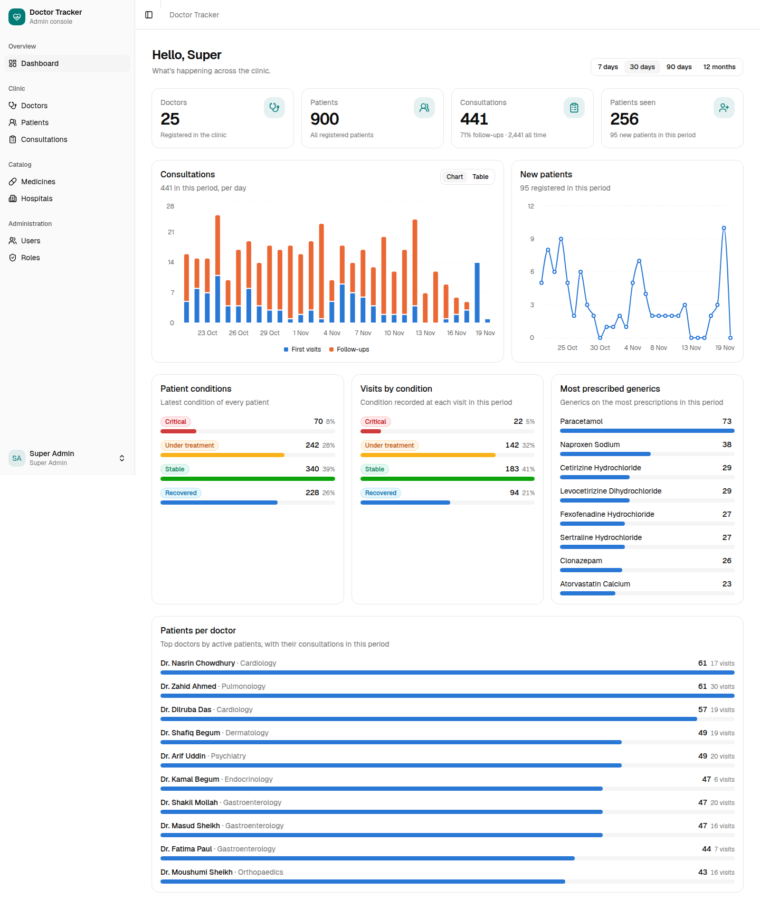

---

## Contents

- [Setup guide](#setup-guide)
- [Demo accounts](#demo-accounts)
- [System architecture](#system-architecture)
- [Technical decisions](#technical-decisions)
- [Visual evidence](#visual-evidence)
- [Project structure](#project-structure)
- [API overview](#api-overview)

---

## Setup guide

### Option A: everything in Docker (one command)

Requirements: Docker with Docker Compose v2.

```bash
git clone <repo-url> doctor-tracker
cd doctor-tracker

# 1. Create the settings file from the template (works as-is for local use)
cp backend/configs/.env.example backend/configs/.env.development

# 2. Start MongoDB, Redis, the API and the web app
docker compose --env-file="./backend/configs/.env.development" up -d --build
```

Open **http://localhost:3000** and sign in with a [demo account](#demo-accounts).

On its first start the backend seeds the database in the background (about 5 seconds): roles, the first admin, the medicine catalog (21,714 brands, 1,711 generics) and, with `SEED_DEMO_DATA=true`, demo hospitals, doctors, 900 patients and ~2,400 consultations. Later starts only add what's missing.

| Service | URL / port (host) | Notes |
|---|---|---|
| Frontend (Next.js) | http://localhost:3000 | `FRONTEND_PORT` |
| API (Express) | http://localhost:5000/api/v1 | `BACKEND_PORT`; health: `/health` |
| MongoDB | localhost:27019 | `MONGO_PORT` |
| Redis | localhost:6381 | `REDIS_PORT` |

Useful commands:

```bash
docker compose --env-file="./backend/configs/.env.development" ps        # status + health
docker compose --env-file="./backend/configs/.env.development" logs -f backend
docker compose --env-file="./backend/configs/.env.development" down      # stop (keeps data)
```

### Option B: run the apps locally (for development)

Requirements: Node.js 22+, npm, Docker (for MongoDB and Redis).

```bash
cp backend/configs/.env.example backend/configs/.env.development

# MongoDB + Redis only
docker compose --env-file="./backend/configs/.env.development" up -d mongodb redis

# API on http://localhost:5000 (watch mode)
cd backend && npm install && npm run dev

# Web app on http://localhost:3000 (another terminal)
cd frontend && npm install && npm run dev
```

The frontend's defaults already point at `http://localhost:5000/api/v1`. To change them, copy [`frontend/.env.example`](frontend/.env.example) to `frontend/.env.local`.

### Configuration

All settings for an environment live in one file, [`backend/configs/.env.example`](backend/configs/.env.example) (copied to `.env.development`). Docker Compose, the backend and the frontend container all read it. The important ones:

| Variable | Purpose |
|---|---|
| `JWT_ACCESS_SECRET`, `JWT_REFRESH_SECRET` | Token signing secrets (≥ 32 chars, different from each other) |
| `ACCESS_TOKEN_TTL`, `REFRESH_TOKEN_TTL` | Token lifetimes in seconds (15 min / 7 days) |
| `SEED_ADMIN_EMAIL`, `SEED_ADMIN_PASSWORD` | First Super Admin, created on first start |
| `SEED_DEMO_DATA`, `SEED_DEMO_PASSWORD` | Import demo data (keep `false` in production) and the demo doctors' password |
| `BACKEND_URL` | Where the Next.js server reaches the API (Compose sets `http://backend:5000/api/v1`) |
| `COOKIE_SECURE` | `true` when served over HTTPS (session cookies get the Secure flag) |
| `TRUST_PROXY` | Proxies allowed to set `X-Forwarded-For` (real client IP for rate limiting) |

### Scripts

| Where | Command | What it does |
|---|---|---|
| backend | `npm run dev` / `build` / `start` | Watch mode / compile / run compiled |
| backend | `npm run typecheck` | Type-check only |
| backend | `npm run seed` | Run the seed on its own (the server also runs it on start) |
| backend | `npm run demo:generate` | Regenerate `data/demo/*.json` (deterministic) |
| frontend | `npm run dev` / `build` / `start` / `lint` | Next.js dev / production build / serve / ESLint |

---

## Demo accounts

| Role | Email | Password |
|---|---|---|
| Super Admin | `admin@doctortracker.dev` | `Admin@12345` |
| Doctor (Cardiology) | `rakib.das.1@demo.doctortracker.dev` | `Doctor@123` |
| Doctor (Endocrinology) | `ayesha.talukder.2@demo.doctortracker.dev` | `Doctor@123` |

All 25 demo doctors are in [`backend/data/demo/doctors.json`](backend/data/demo/doctors.json) and share the password `SEED_DEMO_PASSWORD`. All demo names are fictional. Demo patient phone numbers start with `0199`, e.g. `0199000040` (a returning patient of the cardiologist above), handy for trying the consultation screen.

---

## System architecture

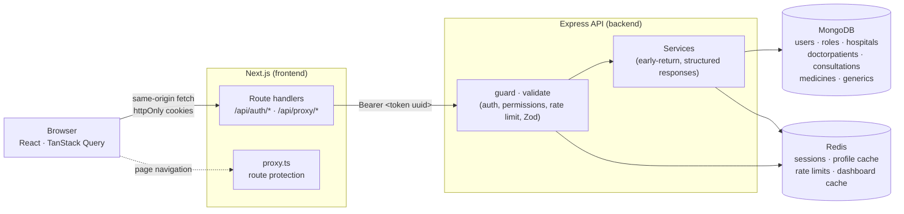

**Request flow.** The browser only ever talks to the Next.js app. Pages are a static shell (prerendered, instant), and data is fetched in the browser with TanStack Query against `/api/proxy/*`. That route handler reads the session from an httpOnly cookie, adds `Authorization: Bearer <uuid>` and forwards the call to Express. On a `401` it refreshes the session once and retries. Express runs `guard` (authenticate → rate limit → permission check) and `validate` (Zod), then a service that returns one response shape for success and failure: `{ success, status, message, data, errors }`. Field errors (`"medicines.0.durationDays": "…"`) map straight onto form fields in the UI.

**Backend modules** (`backend/src/modules`), each with model · validation · service · controller · routes:
`auth` · `role` · `user` · `hospital` · `patient` · `doctorPatient` · `consultation` · `medicine` (+ generics) · `dashboard`.

**Data model, in short**
- **Users** are admins, doctors and patients, distinguished by `userType`, which is copied from their **Role**. Doctors have a `doctorProfile` (printed on prescriptions) and a hospital history. Patients have a `patientProfile.currentCondition`.
- **Roles** hold permissions as JSON (`{ patient: { read: true } }`, or `{ GLOBAL: { hasAllPermission: true } }` for a super admin) and optional subordinate roles. Every possible permission is registered in one file (`shared/permissions/appPermissions.ts`) and the role editor reads it from the API.
- **DoctorPatient** is a doctor's patient list: one entry per doctor-patient pair, with visit count, first and last visit and last condition. Admins can add a patient with no visit yet.
- **Consultation** is one visit, never deleted. It holds the visit number per pair (first visit or follow-up), the condition, diagnosis, notes, prescribed medicines, advice, follow-up date, a unique prescription number (`RX-2026-000123`), and **snapshots** of the doctor and patient, so a reprint always matches what was issued.
- **Medicine** / **Generic** is the catalog, linked brand → generic. The search fields are lowercased copies, so "starts with" search uses an index.

**Performance highlights**
- Every list filter and sort has a matching index. Medicine search uses anchored regexes on normalized fields, so it reads only the matches. A search for `amlo` examines 281 of 21,714 documents.
- The doctor's patient list is a single aggregation: an indexed match, then `$lookup`, then `$facet`, which returns the page and the total count together.
- The dashboard is one `$facet` pass over the period's consultations for the summary, trend, conditions, top generics and per-doctor counts. Days are grouped in the viewer's timezone and empty periods are zero-filled. The result is cached in Redis for 60 seconds.
- Visit numbers come from one atomic `$inc` (via a pipeline update) on the doctor-patient entry, so simultaneous saves never collide. That replaces a transaction, since MongoDB runs standalone here. If inserting the consultation fails, the visit count is rolled back.
- Imports (medicine catalog, demo data) load the existing keys once, find the missing records in memory and bulk-insert them: 23,000+ records in about 3 seconds, and a no-op on later runs.
- On the frontend, filters live in the URL, the previous page stays visible while the next one loads, and the live prescription preview is memoized. The PDF library is loaded only when someone clicks "Download PDF".

---

## Technical decisions

### 1. Tokens in httpOnly cookies behind Next.js route handlers, not in `localStorage`

**The problem.** A separate Next.js client and Express API make the "obvious" setup tempting: log in, keep the JWT in `localStorage`, send it from the browser. But any script running on the page, whether an XSS bug or a compromised dependency, can read `localStorage` and steal the session. The spec grades the authentication implementation and asks for proper protection of every route.

**What we did.** Next.js acts as the client's backend, and the tokens never reach JavaScript at all:
- `POST /api/auth/login` (a Next.js route handler) calls the API, then stores the tokens in **httpOnly, SameSite=Lax** cookies (Secure over HTTPS) and returns only the user profile.
- Every API call goes through `/api/proxy/[...path]`, which adds `Authorization: Bearer …` from the cookie. On a `401` it refreshes once with the refresh cookie, updates both cookies and retries the original request.
- **Simultaneous refreshes share one call.** Refresh tokens are single-use, so without this, two simultaneous requests would both try to refresh and the second would log the user out. Results are kept for 30 seconds so late requests reuse them.
- Writes are rejected unless the `Origin` matches (403), on top of SameSite. `proxy.ts` only checks that a session cookie exists, for instant redirects, and the API still verifies every request.

**Trade-offs.** Every call takes one extra hop through the Next.js server. In return, page scripts can't steal tokens, there's no CORS setup, and the API's address is never exposed to the browser. Because Express now sees the Next.js server as the client, it trusts `X-Forwarded-For` from private networks only (`TRUST_PROXY`), so login rate limits still count real users without letting outsiders spoof their IP.

### 2. Redis-backed sessions with opaque tokens, re-reading only the role from MongoDB

**The problem.** Plain stateless JWTs can't be revoked: a deactivated user or a changed permission keeps working until the token expires. Checking MongoDB for the full user on every request fixes that, but adds cost to every call.

**What we did.**
- Login creates a session in Redis and the client receives two **random uuids**, not JWTs:
  `authtoken:<uuid> → access JWT (15 min)` · `refreshtoken:<uuid> → refresh JWT (7 days)` · `profile:<userId> → user profile`.
- On each request, `authenticate` resolves the uuid and reads the cached profile, then re-reads **only the role** from MongoDB, which is a single query by `_id`. Permission changes therefore apply on the very next request, without invalidating anyone's session.
- When a user is updated or deleted, their cached profile is rebuilt or removed, so deactivation is immediate too. If rebuilding fails, the cache entry is deleted rather than left stale, and the next request reloads it from MongoDB.
- Refresh tokens are **single-use**: they're read and deleted in one Redis `GETDEL`, so a stolen refresh token works at most once. Logout deletes just that device's tokens.

**Trade-offs.** Redis is now required for authentication. If it's down, protected routes return 503 instead of guessing. Everything else is designed to degrade gracefully: the cache helpers and the rate limiter fall back silently, so a Redis outage never breaks the dashboard or login limits. The same Redis also holds rate-limit counters and the dashboard cache.

---

## Visual evidence

### Desktop

| | |
|---|---|
| **Sign in**<br/>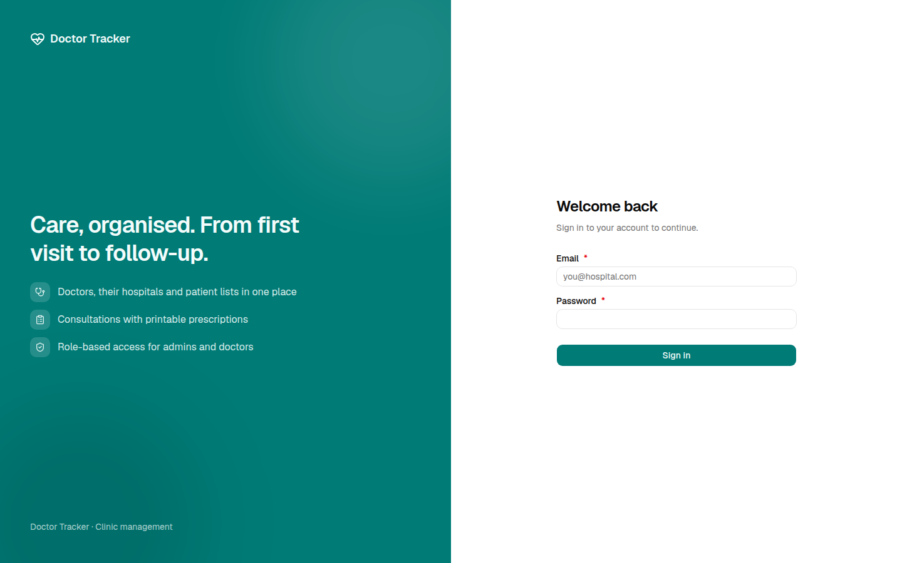 | **Doctors: one doctor's patients**<br/>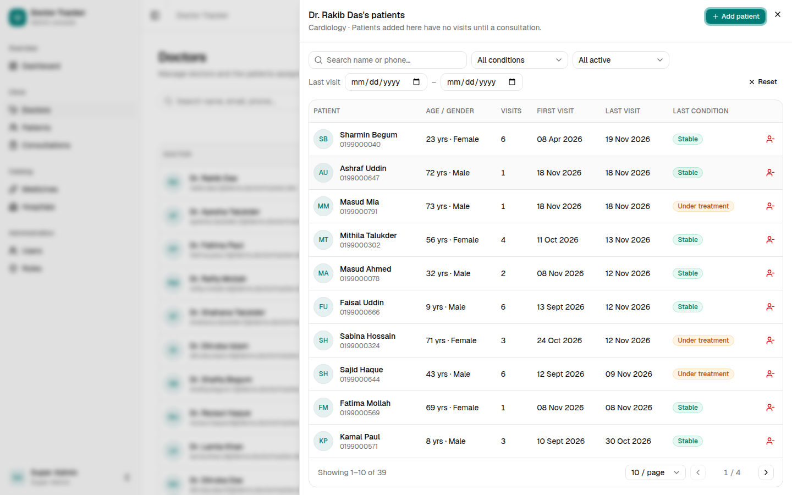 |
| **Patients: filtered by condition**<br/>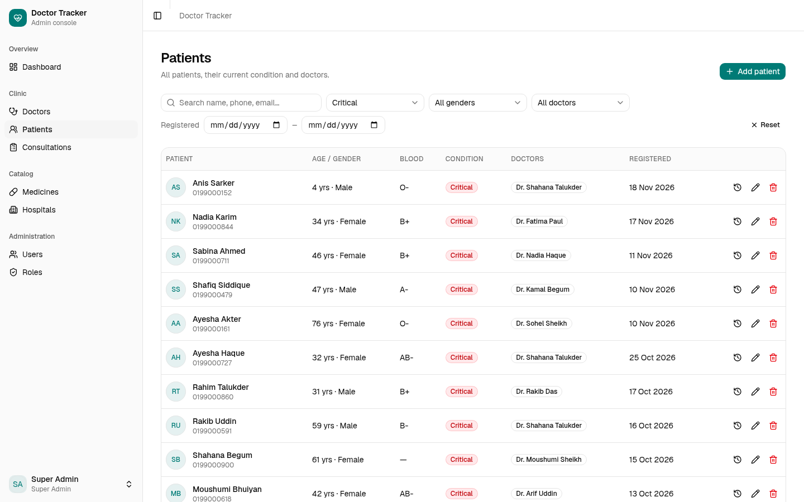 | **Consultations across doctors**<br/>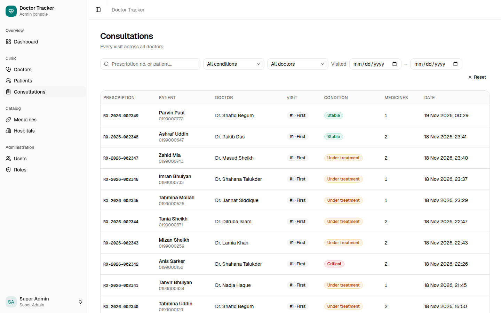 |
| **New consultation with live prescription preview**<br/>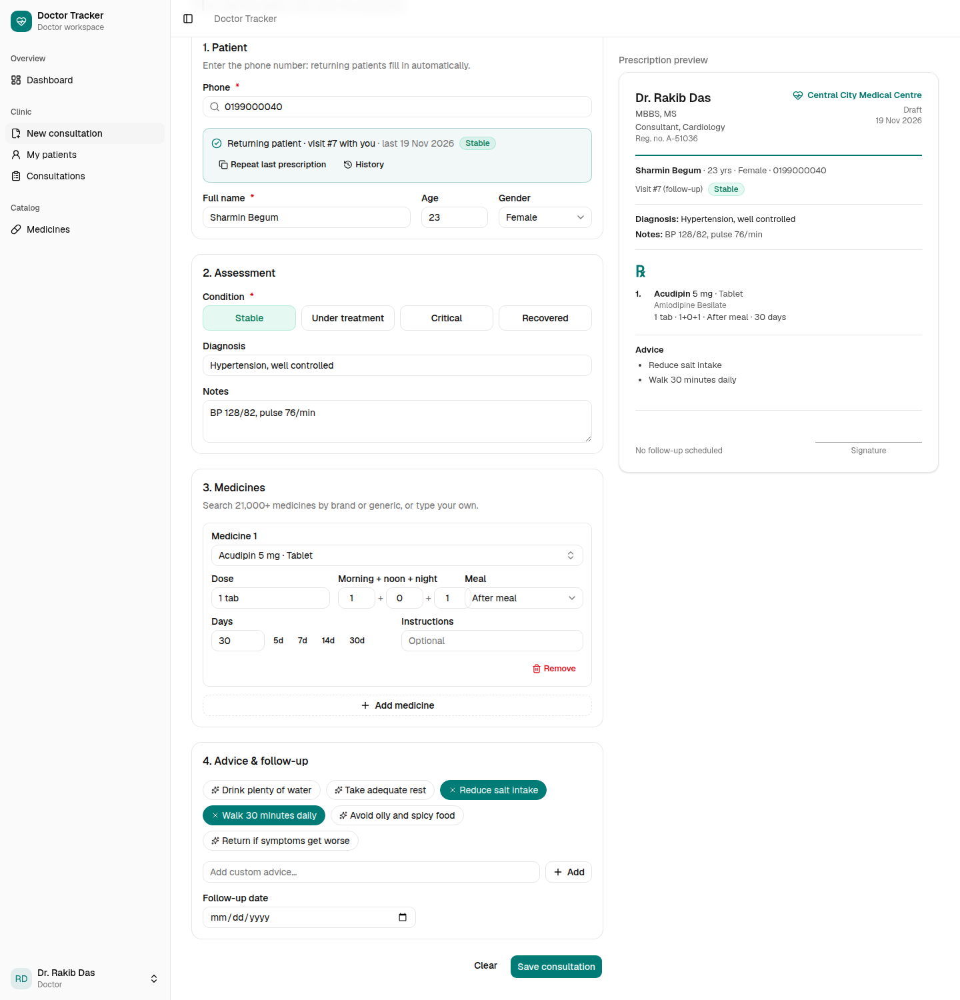 | **Saved prescription (print / PDF)**<br/>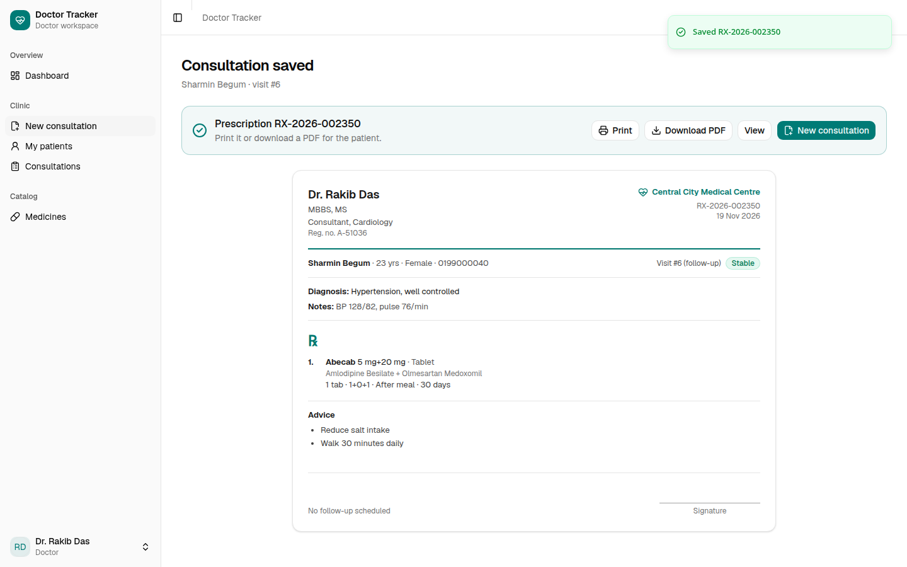 |
| **Doctor's dashboard**<br/>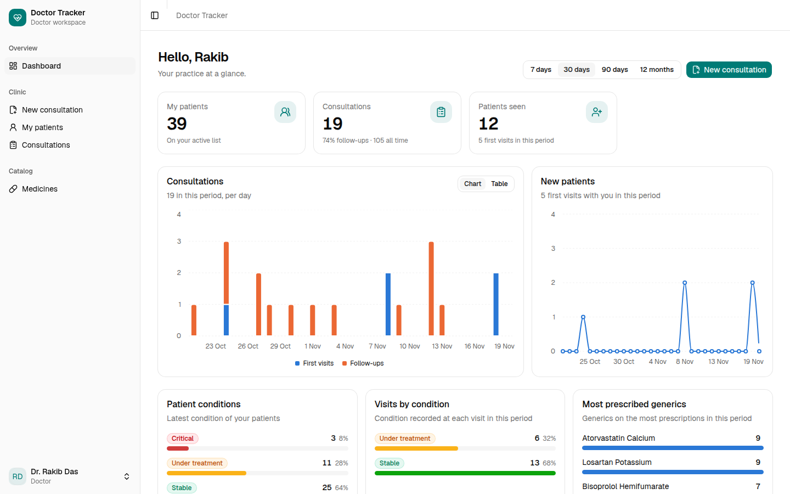 | **My patients (doctor)**<br/>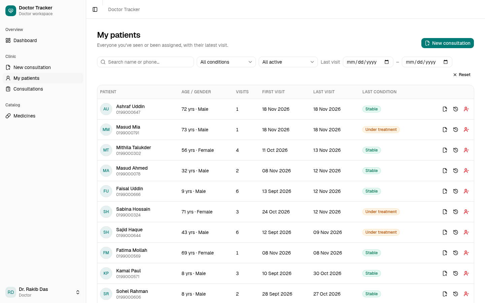 |
| **Medicine catalog: brand or generic search**<br/>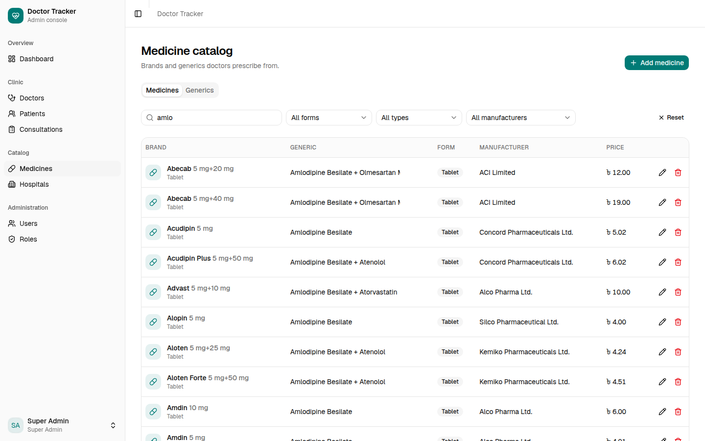 | **Role editor with permission picker**<br/>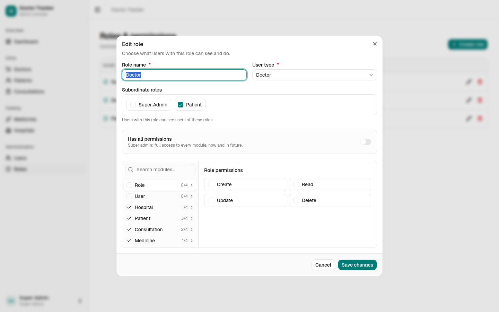 |

### Mobile

| Dashboard | Patients | Consultation (dark mode) |
|---|---|---|
| 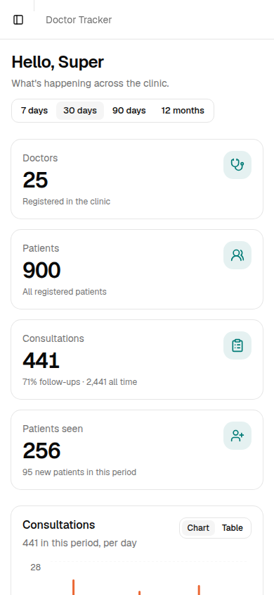 | 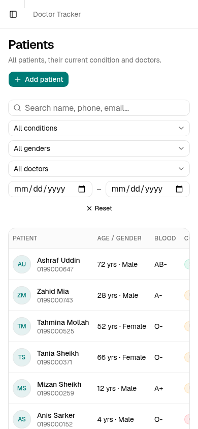 | 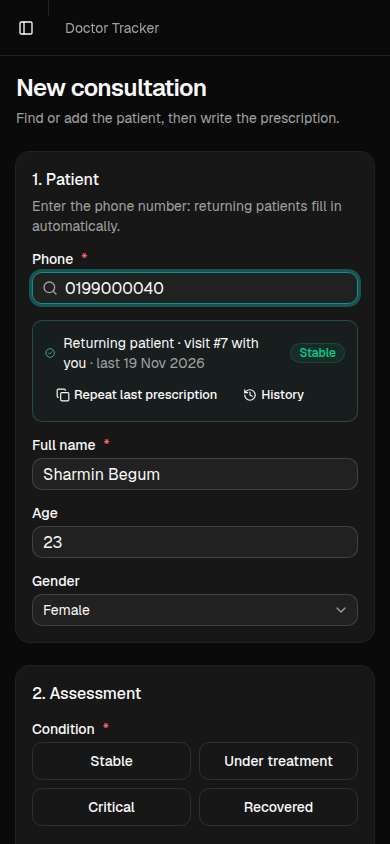 |

---

## Project structure

```
doctor-tracker/
├── docker-compose.yml          # mongodb · redis · backend · frontend
├── backend/
│   ├── configs/.env.example    # all settings for one environment
│   ├── data/                   # medicine catalog + demo data (JSON)
│   ├── Dockerfile
│   └── src/
│       ├── modules/<name>/     # model · validation · service · controller · routes
│       ├── shared/             # middlewares (guard, validate, authenticate), permissions, utils
│       ├── database/           # seed + demo import
│       ├── routes/index.ts     # registers every module's routes
│       └── app.ts · server.ts
├── frontend/
│   ├── Dockerfile
│   └── src/
│       ├── app/                # routes: (auth)/login, (app)/…, api/auth/*, api/proxy/*
│       ├── features/<name>/    # api.ts · hooks.ts · components/ (mirrors backend modules)
│       ├── components/         # ui (shadcn), data-table, form, layout, feedback
│       ├── lib/                # api client, auth (cookies, refresh), permissions, formatting
│       └── proxy.ts            # route protection
└── screenshots/
```

---

## API overview

Base URL `http://localhost:5000/api/v1`. Every protected route needs `Authorization: Bearer <authToken uuid>`, which the frontend proxy adds.

| Area | Endpoints |
|---|---|
| Auth | `POST /auth/login` · `POST /auth/refresh` · `POST /auth/logout` · `GET /auth/profile` · `POST /auth/register` (disabled) |
| Roles | `GET /roles/permissions` (catalog) · CRUD `/roles` |
| Users / doctors | CRUD `/users` (filters: `userType`, `search`, `role`, `hospital`, `specialization`, `createdFrom/To`, paging, sorting) |
| Hospitals | CRUD `/hospitals` |
| Patients | `GET /patients/lookup?phone=` · CRUD `/patients` (filters: `condition`, `gender`, `doctor`, dates, search) |
| Doctor's patient list | `GET`/`POST /doctors/:doctorId/patients` · `DELETE …/:patientId` · `GET …/:patientId/consultations` (`:doctorId` may be `me`) |
| Consultations | `POST /consultations` (doctors) · `GET /consultations` · `GET /consultations/:id` |
| Medicines | `GET /medicines?search=` (brand or generic prefix) · `GET /medicines/manufacturers` · CRUD `/medicines`, `/medicines/generics` |
| Dashboard | `GET /dashboard?from&to&interval&timezone` |

Responses always look like `{ success, status, message, data, errors }`. Lists return `data: { items, meta: { page, limit, total, totalPages } }`.
